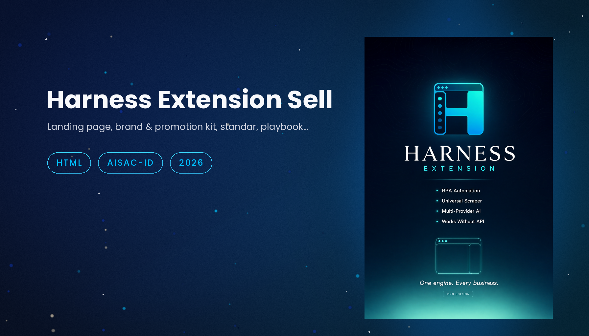
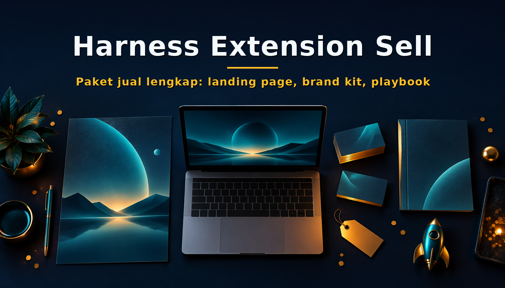
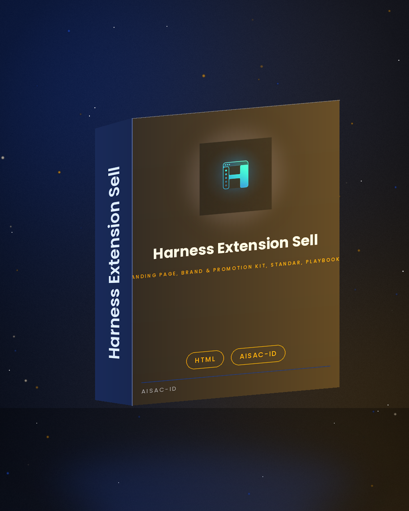
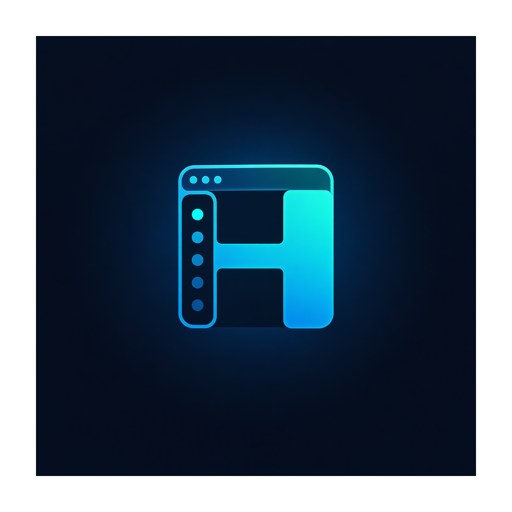
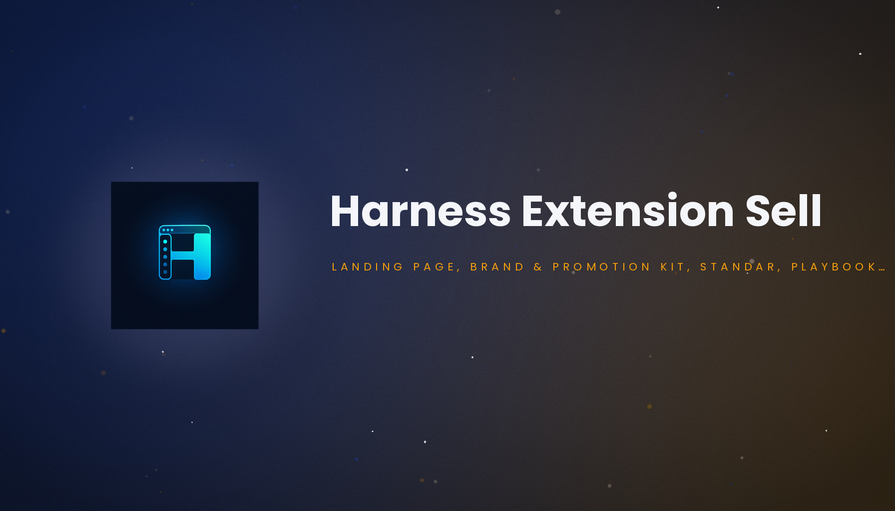
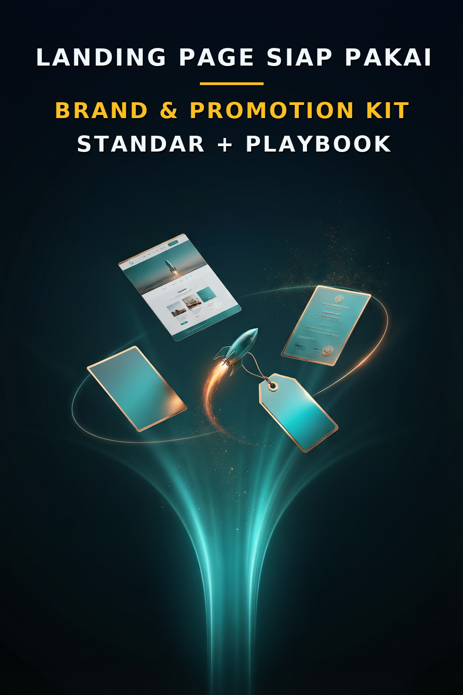
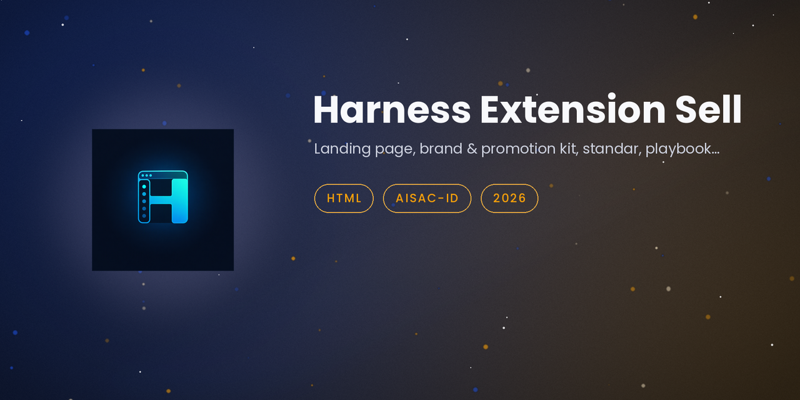
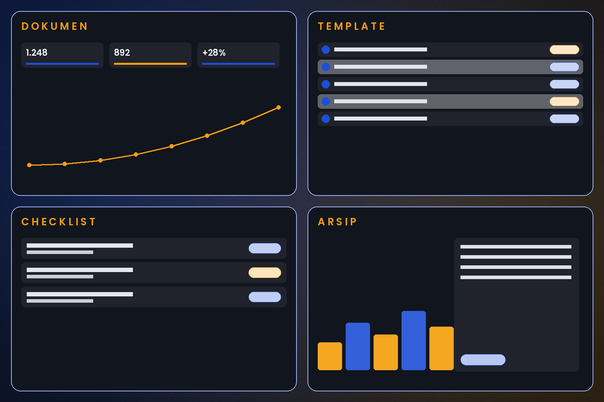
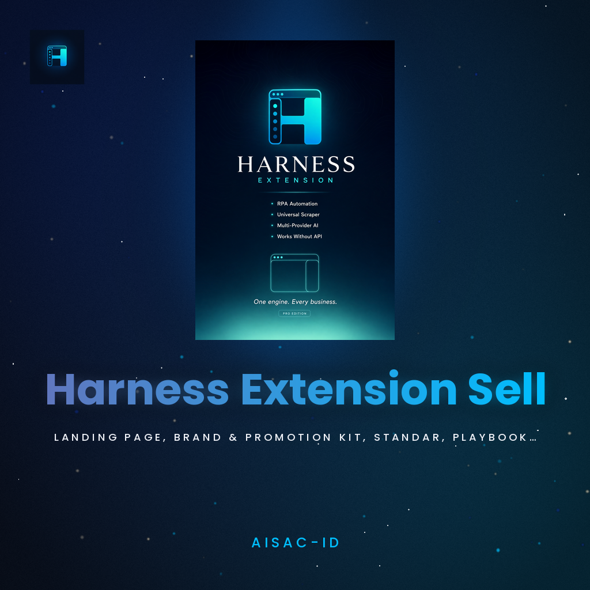

# Harness Extension

  

Standar resmi pembuatan browser extension untuk akun **aisac-id**.
Repo ini adalah **kontrak**: setiap extension baru WAJIB mengikuti seluruh aturan di [STANDARDS.md](STANDARDS.md).

Materi brand & promosi (logo, software box, poster, video): **[brand/](brand/README.md)** · Katalog ide 20 sektor bisnis: **[BUSINESS_PLAYBOOK.md](BUSINESS_PLAYBOOK.md)** · Tutorial UX 12 langkah: **[UX_FLOW.md](UX_FLOW.md)**

## Cara Pakai (untuk pemilik repo)

Cukup berikan ke agent/AI:

1. GitHub token (classic / fine-grained dengan scope `repo`)
2. Repo standar ini: `https://github.com/aisac-id/harness-extension`
3. Perintah singkat, contoh:

> "Buatkan extension **Auto Form Filler** untuk mengisi formulir otomatis.
> Ikuti semua standar di repo `aisac-id/harness-extension` (baca STANDARDS.md dan AGENTS.md).
> Buat repo public baru `aisac-id/auto-form-filler`, lalu push ke sana."

Template perintah lengkap ada di [PROMPT_TEMPLATE.md](PROMPT_TEMPLATE.md).

## Ringkasan Aturan Inti

| Aspek | Aturan |
|---|---|
| Ukuran file | Maks **300 LoC per file** (tanpa komentar/baris kosong dihitung tetap <= 300 total) |
| Paradigma | **OOP** — class ES6+, satu class satu tanggung jawab, satu file satu class utama |
| Platform | Chrome **Manifest V3** (kompatibel Edge/Brave), service worker, bukan background page |
| Performa | Ringan: vanilla JS / maksimal Preact, total bundle < 500 KB, tanpa framework berat, event-driven (bukan polling) |
| UI | **Sidebar 1/4 viewport** di pinggir kanan + mode **rail** dan **fullscreen** (shortcut), collapsible, **tab vertikal**, **Full Settings** (semua perilaku configurable, export/import, test connection) |
| RPA | Semua extension harus RPA-ready: action layer terpisah, selector engine, recorder/player opsional, script JSON export/import |
| Konektivitas | Bisa connect ke **situs/API tertentu** (SiteAdapter), **desktop app** (Native Messaging + companion host), dan **terminal/CLI** (whitelist command, loopback + pairing token) — semua via `ConnectionHub`, default OFF |
| Platform Bridge | Extension jadi **worker RPA untuk platform**: platform kirim job via **ingest token** → extension RPA di sesi login user (mis. LinkedIn, tanpa API/MCP) → hasil dikirim ke endpoint ingest platform (outbox queue, idempotent, auto-pause saat blocked) |
| Scraper & Pipeline | Panen apa pun: **gambar, teks/tabel, novel (TXT/EPUB/MD), download file** → pipeline clean/dedupe → **IndexedDB** → analisis & preview di tab "Data" → export JSON/CSV/ZIP atau kirim ke platform. **RPA-first, tanpa API/MCP**; API/MCP opsional bila tersedia |
| LLM | **Multi-provider**: OpenAI-compatible (OpenAI/Groq/DeepSeek/OpenRouter/xAI/dll), Anthropic, Gemini, **lokal Ollama** — provider baru = 1 class. Fallback chain, streaming, batas biaya, privasi per tugas |
| Secret & .env | **SecretVault terenkripsi** (AES-GCM + PBKDF2), **import file .env** via Settings, `.env.example` + `.gitignore` wajib, secret tidak pernah di bundle/log |
| UX | **Onboarding 12 langkah bernomor** dengan penjelasan + demo nyata ([UX_FLOW.md](UX_FLOW.md)), guided tour, bisa diulang |
| Bisnis & Jual | **Lisensi offline Ed25519**, editions Free/Pro/Bundle/Enterprise, **bundling dengan buku/video/apa pun** via kode, white-label. Katalog 20 sektor: [BUSINESS_PLAYBOOK.md](BUSINESS_PLAYBOOK.md) |
| Keamanan | Permission minimum, tanpa eval/remote code, tanpa secret hardcoded |

Detail lengkap, struktur folder, dan checklist acceptance: **[STANDARDS.md](STANDARDS.md)**.

## Keamanan Token

- Jangan pernah commit token ke repo mana pun.
- Gunakan token hanya untuk operasi yang diminta, lalu sarankan rotate bila token pernah dibagikan di chat.
- Disarankan fine-grained token dengan akses repo terbatas.

---

## Brand & Promotion Kit

Aset branding resmi **Harness Extension Sell** — logo, software box, poster, banner, dan materi sosial.
Semua aset berada di folder [`promo/`](promo/) dan bebas dipakai untuk materi promosi proyek ini.

  

| Aset | Pratinjau | Ukuran |
|---|---|---|
| Logo |  | 1024×1024 |
| Wordmark |  | 1600×500 |
| Software Box |  | 1600×1200 |
| Poster |  | 1200×1600 |
| Banner |  | 1920×820 |
| Social Preview |  | 1280×640 |
| Feature Showcase |  | 1600×1000 |
| Social Square |  | 1080×1080 |
